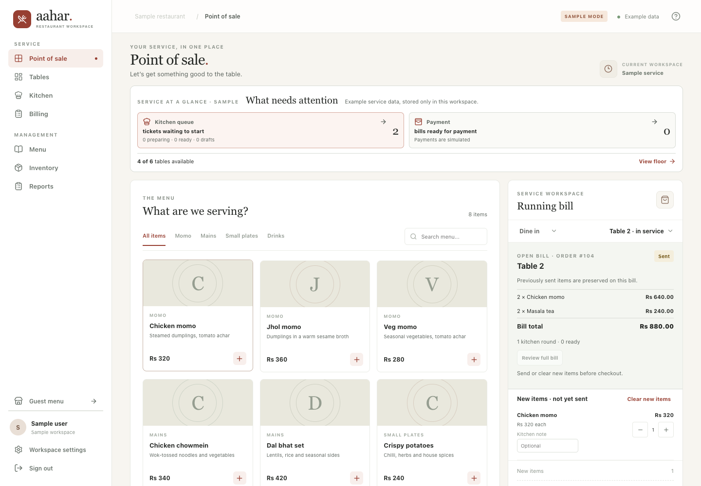
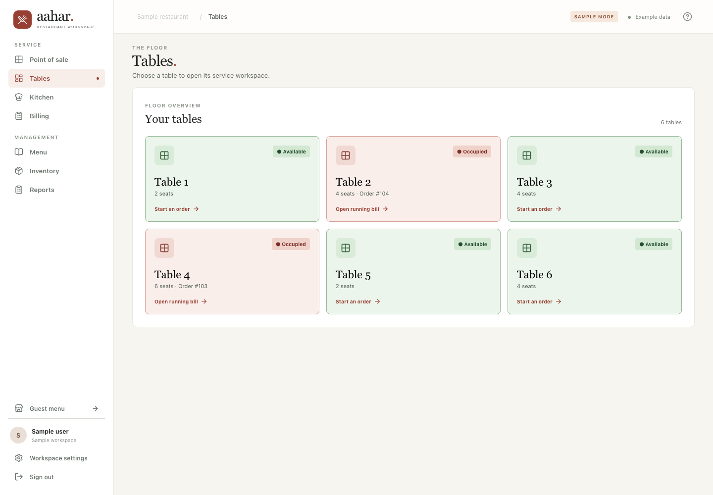
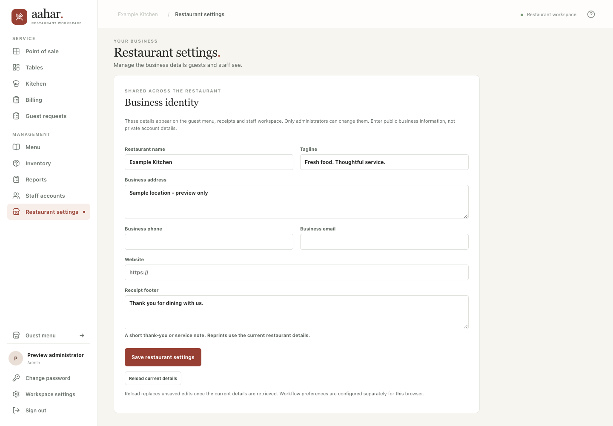
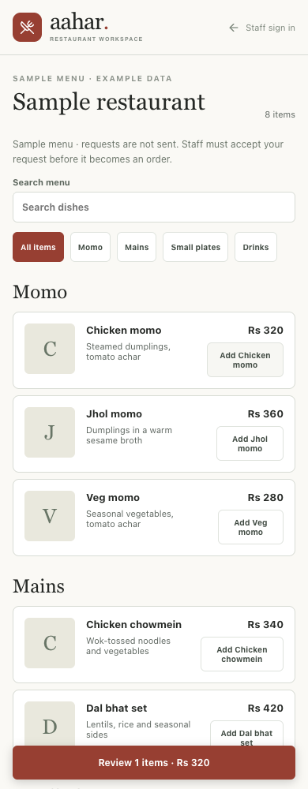
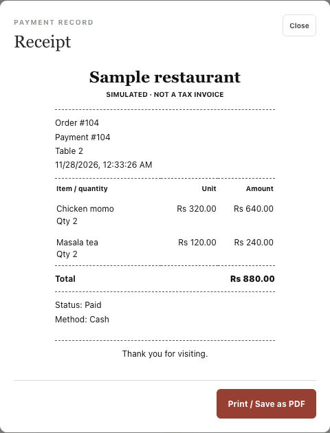

# Aahar

**Restaurant operations, from the first order to the last table.**

Aahar is a full-stack restaurant application built with **ASP.NET Core, React
and PostgreSQL**. It brings ordering, table service, kitchen preparation,
inventory and billing into one workspace, with a separate guest-facing menu.
Each local installation serves one restaurant.

The project demonstrates clean architecture, transactional business workflows,
role-based authorization and a purpose-designed hospitality interface.

[Getting started](#getting-started) · [Screenshots](#screenshots) ·
[Architecture](#architecture) · [Documentation](#documentation)

## Features

| Area | Capabilities |
| --- | --- |
| Ordering and tables | Dine-in and takeaway orders, editable drafts, green/red table availability, running bills and additional kitchen rounds |
| Kitchen | Separate preparation tickets per round, queued/preparing/ready stages and immutable item snapshots |
| Billing | Full-balance settlement, historical item prices, printable 80 mm receipts and receipt previews |
| Guest experience | Searchable menu, categories, mobile cart, table/takeaway links and requests reviewed by staff |
| Menu and inventory | Menu images, availability, recipes, stock deductions, low-stock thresholds, waste and movement history |
| Purchasing | Suppliers, purchase receipts, ingredient quantities and unit-cost snapshots |
| Reporting | Business-date sales summaries and best-selling items |
| Administration | Staff roles, shared restaurant details, account password changes and browser-specific workflow preferences |

## Screenshots

Screenshots show the running interface with fictional preview data, not real
restaurant records. The restaurant-settings preview uses a mocked administrator
session; the other views use the application's in-memory sample workspace.

### Point of sale



### Table service



<details>
<summary>Restaurant settings, mobile guest menu and receipt</summary>






</details>

## Technology

| Layer | Stack |
| --- | --- |
| Frontend | React, TypeScript, Vite, Lucide icons, CSS |
| API | .NET 10, ASP.NET Core, cookie authentication, antiforgery middleware |
| Application | Use-case contracts, interfaces, DTOs, Mapster |
| Persistence | PostgreSQL, EF Core, Npgsql, explicit migrations |
| Testing | xUnit, ASP.NET integration tests, PostgreSQL workflow/concurrency tests, Node test runner |
| CI | GitHub Actions, isolated PostgreSQL 18 service, backend and frontend quality gates |

## Architecture

```text
web/                         React staff workspace and guest menu
    |
Aahar-API/                   HTTP endpoints, middleware and dependency injection
    |
Aahar.Application/           Application contracts and DTOs
    |
Aahar.Domain/                Framework-independent entities and business rules

Aahar.Infrastructure/        Persistence, storage and service implementations
Aahar.Tests/                 Backend tests
docs/                        Implementation book, branding and project guides
```

Dependencies point inward: the domain has no dependency on HTTP, EF Core or
React. Infrastructure implements application boundaries and is wired through
dependency injection in the API host. Mapster maps DTOs, not business decisions.

Order submission, stock deduction and ticket creation are transactional.
Payments settle the complete bill once. Monetary values use decimal arithmetic
and explicit rounding; order and purchase records preserve price snapshots.
Authorization and validation remain on the server.

See the [architecture guide](Aahar-API/ARCHITECTURE.md) and
[security guide](Aahar-API/SECURITY.md) for the detailed design and tradeoffs.

## Getting started

### Prerequisites

- .NET 10 SDK
- Node.js 24 and npm
- PostgreSQL 18 for the database-backed application
- Git

### Clone and restore

```bash
git clone https://github.com/kriteshpokhrel/aahar.git
cd aahar
dotnet restore Aahar-API.slnx
dotnet tool restore
npm --prefix web ci
```

### Try the interface without a database

```bash
npm --prefix web run dev -- --host localhost
```

Open `http://localhost:5173` and choose **Explore sample workspace**. Sample
orders remain in memory and are discarded on refresh. The sample guest menu is
available at `http://localhost:5173/?guest=sample`. Real sign-in requires the
HTTPS setup below.

### Configure the database and administrator

Follow the [backend setup guide](Aahar-API/BACKEND.md#setup) to:

1. Select a new, dedicated PostgreSQL database provisioned by its owner.
2. Configure the connection privately, review migration SQL and explicitly approve applying it to that target.
3. Bootstrap the first administrator using interactive prompts.
4. Optionally seed fictional demonstration menu and inventory data into an empty restaurant database.

The application never creates or migrates a database on startup. Do not put
passwords in source files, shell history or documentation.

**Existing installations:** the current source requires both running-rounds
migrations, `20261127174754_RunningOrderRounds` and
`20261127174813_RoundLedgerConstraints`. Do not run it against an older schema
without an approved upgrade and backup. The frontend disables additional rounds
when connected to an older API. See [operations](Aahar-API/OPERATIONS.md).

### Run the full application

In the backend terminal, retain the private database connection configured
during setup:

```bash
dotnet dev-certs https --trust
dotnet run --project Aahar-API --launch-profile https
```

In a second terminal, export the trusted development certificate outside the
repository and start the HTTPS frontend:

```bash
mkdir -p "$HOME/.local/share/aahar/tls"
chmod 700 "$HOME/.local/share/aahar/tls"
umask 077
dotnet dev-certs https --export-path "$HOME/.local/share/aahar/tls/localhost.pem" --format PEM --no-password
export AAHAR_DEV_CERT="$HOME/.local/share/aahar/tls/localhost.pem"
export AAHAR_DEV_KEY="$HOME/.local/share/aahar/tls/localhost.key"
npm --prefix web run dev -- --host localhost
```

Open **https://localhost:5173**. The frontend proxies `/api` to
**https://localhost:7041**. Keep the certificate key private and the development
servers bound to localhost.

After signing in as an administrator, open **Management / Restaurant settings**
to configure the business name, tagline, public contact details and receipt
footer. This shared profile is stored separately from PostgreSQL; protect and
back it up with the installation's database and menu images.

## Development

Run these commands from the repository root:

```bash
dotnet build Aahar-API.slnx --configuration Release --warnaserror
dotnet test Aahar.Tests/Aahar.Tests.csproj --configuration Release
npm --prefix web run lint -- --deny-warnings
npm --prefix web run build
npm --prefix web test
```

PostgreSQL tests are opt-in locally. Use only an approved, dedicated `aahar_test`
database with the required schema; see the backend guide for the environment
variables. CI enables them against its own fresh service database.

## CI and contributing

[GitHub Actions](https://github.com/kriteshpokhrel/aahar/actions/workflows/ci.yml)
runs **Backend build and tests** and **Frontend build and tests** on pushes,
pull requests targeting `main`, and merge-queue groups. The backend job also
checks migration coverage and exercises PostgreSQL workflows and races.

Changes should arrive through a pull request with both checks passing. The
main-branch policy blocks force pushes and requires up-to-date CI checks;
existing review restrictions are preserved. Workflow details and repository
policy verification are documented in [the CI guide](docs/ci.md).

Read [AGENTS.md](AGENTS.md) before contributing. Keep changes focused, preserve
the clean architecture boundaries, add relevant tests and update the associated
documentation.

## Documentation

| Guide | Purpose |
| --- | --- |
| [Implementation book and branding kit](docs/implementation-book.md) | Product scope, feature inventory, phased delivery, visual direction and acceptance criteria |
| [Agent guide](AGENTS.md) | Repository working agreements and database safety |
| [Backend setup and API contract](Aahar-API/BACKEND.md) | Configuration, migrations, endpoints and behavior |
| [Architecture](Aahar-API/ARCHITECTURE.md) | Dependency direction and design decisions |
| [Operations and recovery](Aahar-API/OPERATIONS.md) | Deployment, coordinated backups, upgrades and recovery |
| [Security](Aahar-API/SECURITY.md) | Authentication, authorization and trust limitations |
| [Frontend guide](web/README.md) | HTTPS development, UI workflows and browser behavior |
| [CI and merge protection](docs/ci.md) | Quality gates, test isolation and GitHub requirements |

## Scope and limitations

This is a locally deployed portfolio application, not a hosted multi-tenant
service. Payments are simulated; receipts are not tax invoices or Nepal IRD
certified. A localhost QR link cannot be opened from a guest's phone.

Full end-to-end, upgrade/recovery, accessibility and physical thermal-printer
coverage remain incomplete. The implementation book distinguishes implemented
features, verified deployment behavior and planned work.

## License

No license file is currently provided. Do not assume an open-source license.
